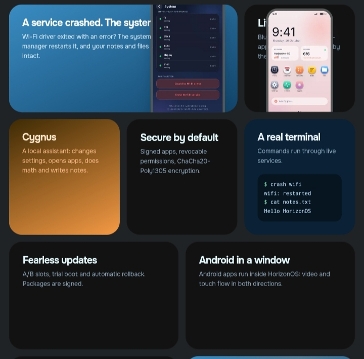

# HorizonOS

**HorizonOS** is a mobile operating system written in Rust: the **Quantum** microkernel, a set of system services with capability-based security, its own graphical shell **Helios-lite**, a set of built-in apps, and several ways to run the very same system:
<p align="center">
  
</p>

| Way to run | What it is | Where |
|---|---|---|
| **Android launcher** | The OS as an Android home screen: kernel, services and shell run inside the APK, and the picture is composed on the GPU (OpenGL ES 3) | `crates/launcher`, `crates/gpu`, `HorizonOS-GPU.apk` |
| **Browser (WebAssembly)** | The same OS built for `wasm32`, with a "phone" web page | `crates/web`, `web/` |
| **ARM64 / QEMU** | An image for `qemu-system-aarch64` (`virt`): runs at EL1 or as an EL2 hypervisor (VHE), with EL0 and stage-2 isolation self-tests | `boot/`, `user/`, `crates/bsp` |
| **Host (Linux/macOS/Windows)** | A simulator for development, screenshots and tests; services can be run as separate OS processes | `crates/hostsim`, `crates/usermode` |

The code of the services, the kernel and the shell is the same in all modes; only the "hardware" layer (screen, touch, audio, network) differs.


---

## Contents

1. [Architecture](#architecture)
2. [Repository layout](#repository-layout)
3. [The Quantum kernel (`kcore`)](#the-quantum-kernel-kcore)
4. [System services](#system-services)
5. [Storage: journal and Veritas](#storage-journal-and-veritas)
6. [Security: crypto, Aegis, Update, Chronos](#security-crypto-aegis-update-chronos)
7. [Networking and the Android stream](#networking-and-the-android-stream)
8. [User-space isolation](#user-space-isolation)
9. [ARM64: boot, EL0, interrupts, EL2](#arm64-boot-el0-interrupts-el2)
10. [Guest VMs (`vmm`)](#guest-vms-vmm)
11. [Graphics and the Helios-lite shell](#graphics-and-the-helios-lite-shell)
12. [Apps](#apps)
13. [Android launcher and GPU compositor](#android-launcher-and-gpu-compositor)
14. [Browser build and web apps](#browser-build-and-web-apps)
15. [Audio](#audio)
16. [Tools and simulator](#tools-and-simulator)
17. [Build and run](#build-and-run)
18. [Tests and CI](#tests-and-ci)
19. [Limits of the current implementation](#limits-of-the-current-implementation)
20. [protocols](#protocols)

---

## Architecture

```
                       ┌────────────────────────────────────────────────────────────┐
  apps                 │  Clock · Calendar · Calculator · Notes · Files · Settings  │
  (inside the shell)   │  Terminal · Phone · Messages · Contacts · Photos · Camera  │
                       │  Browser · Music · Maps · Weather · Health · Wallet …      │
                       │  Cygnus · YouTube/Vimeo/Spotify/OSM/Lightprint/Web · Android│
                       └───────────────────────────┬────────────────────────────────┘
                                                   │  Helios-lite (crates/ui): rasterizer, gestures, shade, lock screen
   ┌───────────────────────────────────────────────┴────────────────────────────────────────────────────┐
   │ Services (crates/services), each with its own kernel process object and its own capability table    │
   │ sysman ─ fs ─ wifi ─ clock ─ input ─ display ─ audio ─ android ─ aegis ─ update ─ chronos ─ term ─ shell│
   └───────────────────────────────────────────────┬────────────────────────────────────────────────────┘
                                                   │  system calls kcore::Sys (channels, VMO, timers, spawn, kill)
   ┌───────────────────────────────────────────────┴────────────────────────────────────────────────────┐
   │ Quantum (crates/kcore): processes · capabilities · IPC channels · VMO (copy-on-write) · EDF+fair-share│
   └───────────────────────────────────────────────┬────────────────────────────────────────────────────┘
                                                   │  Platform (crates/services/platform.rs): touch, framebuffer, audio, network, clock
        ┌───────────────┬───────────────────┬──────┴──────────────┬───────────────────────────┐
        │ Android APK   │ Browser (wasm32)  │ ARM64 / QEMU        │ Host (tests, screenshots, │
        │ crates/launcher│ crates/web + web/ │ boot/ + crates/bsp  │ service processes)        │
        │ + crates/gpu  │                   │ (EL1 / EL2 VHE)     │ crates/hostsim, usermode  │
        └───────────────┴───────────────────┴─────────────────────┴───────────────────────────┘
```

Key principles:

- **Microkernel.** The kernel knows only processes, rights (capabilities), channels, shared memory (VMO) and timers. Everything else is a service.
- **Least privilege.** A service sees only numeric descriptors in its own table; `sysman` hands out channels to other services only according to an explicit `allow` list; a denial is written to the log (`DENIED lookup`).
- **A service crash does not bring down the system.** `sysman` restarts a crashed service (at most 8 times); its state lives in a VMO that survives the restart; the shell shows a recovery notification.
- **One code base, many platforms.** `Platform` ties the "hardware" to the services in the same way for the host, the browser, QEMU and Android.
- **Untrusted input.** Everything that comes from a service process, a guest VM, the network, a video stream or an ELF file is parsed with bounds checking and never causes panics (covered by fuzzing).

---

## Repository layout

```
Cargo.toml            workspace (15 crates); the dev profile is built with opt-level = 3
Makefile              test · shots · build · run · run-el1 · isolated · clean
build_web.sh          build of the browser version (wasm32)
HorizonOS-GPU.apk     prebuilt Android launcher (arm64-v8a, ≈3.9 MB)
boot/                 image for aarch64-unknown-none (QEMU virt): boot.S, vectors.S, main.rs, el0rt/el0svc/hyprt/irqrt, ISOLATION.md
user/                 hz-el0 — a universal service ELF for EL0 (aarch64-unknown-none-softfloat)
crates/               kcore · services · ui · bsp · hzwire · hzrt · el0host · usermode · vmm · h264 · stream · gpu · launcher · web · hostsim
web/                  the phone page, the JS driver horizon.mjs, the built-in Lightprint web app, Node/Chromium tests
tools/                scrcpy_ws_bridge.py · android_demo.sh · build_apk_ubuntu.sh · genfont.py · genmono.py
shots/ shots_tour/    screenshots of the real framebuffer (shell and apps)
.github/workflows/    ci.yml (host, wasm, arm64, vmm, guest-kernel) · build.yaml (APK)
```

| Crate | `no_std` | Purpose | Tests (`#[test]`) |
|---|---|---|---|
| `kcore` | yes | Quantum kernel: processes, capabilities, channels, VMO, scheduler | 13 |
| `services` | yes | system services, protocols, `Platform` | 80 |
| `ui` | yes | rasterizer, fonts, shell, apps, i18n, sound engine | 49 |
| `bsp` | yes | UART, fw_cfg/ramfb, virtio-input, timer, MMU, EL0, stage-2, GICv2/v3, IRQ, allocator | 39 |
| `hzwire` | yes | wire format of system calls (trust boundary) | — (covered by `usermode` and `el0host` tests) |
| `hzrt` | yes | service runtime in EL0 | 1 |
| `el0host` | yes | kernel side for EL0 services: strict ELF loader, ASID pool | 22 |
| `usermode` | no | each service is a separate host OS process (sockets) | 8 |
| `vmm` | yes | guest VM support: arm64 Linux boot, DTB, virtio-mmio | 8 |
| `h264` | yes | H.264 Constrained Baseline decoder | 17 |
| `stream` | yes | sans-io: WebSocket, scrcpy, Annex-B | 8 |
| `gpu` | no | OpenGL ES 3 / EGL compositor | 6 |
| `launcher` | no | Android launcher (`cdylib`, NativeActivity) | — (verified on a device) |
| `web` | no | C-ABI for the browser | 5 |
| `hostsim` | no | host simulator, screenshots, network driver | 10 |

In total the repository contains ≈14.5k lines of Rust (dense style), ≈0.6k lines of AArch64 assembly and 266 tests.

---

## The Quantum kernel (`kcore`)

The kernel is a microkernel model that works as a `no_std` library and runs identically on the host, in wasm, on Android and in the ARM64 image.

**Objects.** A process (`Pid`), a descriptor (`Handle` — a number in the process table), rights `Rights` (`READ`, `WRITE`, `DUP`, `TRANSFER`), a channel (two endpoints with a queue, limited to `QUEUE_MAX = 256` messages), and a VMO — a shared memory object.

**System calls** (`kcore::Sys`, 18 methods): `pid`, `now`, `log`, `bootstrap`, `channel_create`, `send`, `handle_close`, `handle_dup` (with rights attenuation), `vmo_create`, `vmo_size`, `vmo_read`, `vmo_write`, `vmo_clone` (copy-on-write), `vmo_shared_pages`, `set_timer`, `spawn`, `spawn_named`, `kill`. The `spawn` method (passing a service object) is possible only inside the kernel; across an address-space boundary `spawn_named` is available — launching by name through a `Launcher`. Errors: `BadHandle`, `NoRights`, `WouldBlock`, `PeerClosed`, `QueueFull`, `OutOfRange`, `NoSuchProcess`, `WrongType`, `QuotaExceeded`, `Unsupported`.

**Passing rights.** A descriptor can be passed through a channel if it has `TRANSFER`; rights can only be weakened when passing and duplicating.

**VMO.** Paged memory with copy-on-write clones; shared pages are accounted for (`vmo_shared_pages`). Per-process quotas: up to `MAX_HANDLES = 1024` descriptors and `MAX_VMO_BYTES = 16 MiB` per object.

**Lifetime accounting.** VMO reference counters, channels are freed when both ends are closed, a cycle collector; a process's death releases everything it owned. A service crash (`Fault`) is isolated and reported to the parent with an `on_proc_exit` event.

**Scheduler** (`sched.rs`): a hybrid of **EDF** for tasks with a deadline (the `input` service — 5 ms) and **weighted fair-share** (vruntime) for everything else, with `Interactive`/`Background` classes and affinity to P/E cores (`CoreKind::Perf/Eff`). A new task starts with the minimum vruntime so that it neither starves nor monopolizes.

**Timers** are a time-ordered heap; **interrupts for user-space drivers**: `Kernel::irq_bind(id, pid)` and `irq_deliver(id, count)` turn an interrupt into a message `[0xF1, id, count]` to the driver; one interrupt — one driver, the queue is bounded, and the driver's death frees the number.

**Service model** — the `Service` trait: `on_start`, `on_message`, `on_peer_closed`, `on_timer`, `on_proc_exit`. A service receives a `Ctx` — a thin wrapper over `Sys` — so it does not know where it runs (in the kernel or in a separate process).

---

## System services

`Platform::boot()` starts `sysman`, and it starts the other services from the `platform::entries()` table:

| Service | Class | Access (`allow`) | What it does |
|---|---|---|---|
| `sysman` | Interactive | — | launching, handing out channels by name, restarts (up to 8 times), saving state VMOs, status; ACL checks (`enforce`) |
| `fs` | Background | — | file service on top of Veritas and the two-slot journal (state VMO of 256 KiB) |
| `wifi` | Background | — | radio simulator: networks `HorizonNet-5G`, `Home_WiFi`, `Cafe Guest`, `Airport Free`, signal level varies over time, remembers the last network |
| `clock` | Background | — | date and time; `C_SET` sets the host/browser time; survives a restart |
| `audio` | Interactive | — | synthesizer and PCM playback (see [Audio](#audio)) |
| `android` | Interactive | — | remote Android window: H.264 decoder, frame assembler, stream protocols |
| `input` | Interactive, 5 ms deadline | — | gesture engine: touch → tap / long (≥450 ms) / swipe (L/R/U/D, threshold 14 px); keys |
| `display` | Interactive | — | framebuffer in a VMO, `D_PRESENT`, `D_WEB` (web window over the screen) |
| `aegis` | Background | — | permissions, manifests, audit, key store |
| `update` | Background | — | A/B updates, rollback, Merkle verification, measured boot |
| `chronos` | Background | `aegis` | app virtual machine |
| `term` | Interactive | `fs`, `wifi`, `clock`, `sysman` | command interpreter |
| `shell` | Interactive | `fs`, `wifi`, `clock`, `input`, `display`, `term`, `audio`, `android`, `sysman` | shell: UI state, rendering, connection to all services |

Other details:

- **Platform** (`platform.rs`) — the bridge between the "hardware" and the services: touch and keys → `input`; reading the framebuffer (whole and by changed rectangle); frame counter; clock; audio (`audio_attach`, `audio_pull`); network driver for `android` (`net_poll`, `net_link`, `net_rx`); web page request (`web_view` + generation counter); list of host apps (`set_host_apps`, batched icon transfer in chunks of 16 rows).
- **Passage of time.** `run_to(now_ms)` advances the kernel in steps of at most 10 ms (and at most half a frame); if the host falls behind by more than 2 frames, frames that would not be displayed are not drawn (`BEHIND`).
- **Screen size.** By default a 480×960 grid (`SCREEN_W`, `SCREEN_H`); the host (launcher) sets the real size through `set_screen_size` before boot.
- **Terminal** (`term`) — commands are executed through the real services: `ls cat head tail wc grep hexdump sha256 stat touch mkdir rm [-r] cp mv echo > >> df`, snapshots `snap snaps restore`, `ps neofetch uname uptime whoami`, `wifi [scan|on|off|connect]`, `date`, `crash wifi|fs`, `calc`, `env export history`, `help [cmd]`; pipelines `| grep [-v] | head | tail | wc | sort [-r] | uniq | rev`; quoting and `$VAR`; Tab completion, ↑/↓ history, Ctrl-C, swipe scrolling, a timeout when a reply is lost.

---

## Storage: journal and Veritas

**Journal** (`journal.rs`): two slots with CRC32. A commit writes the payload to the inactive slot and only then the header (magic `JRNL`, generation, length, CRC). On boot the valid slot with the highest generation wins. An interrupted write at **any byte** loses at most the new commit, but never the old data (verified by a test that cuts the power at every byte).

**Veritas** (`veritas.rs`) is a storage engine on top of the journal:

- content-addressed blobs (**deduplication**) and a path tree;
- copy-on-write **snapshots** (up to `MAX_SNAPS = 8`), rollback, clones;
- **transparent encryption** of the `secure/*` path: ChaCha20-Poly1305, a per-file nonce, a volume key via HKDF; the encryption is bound to the path;
- the whole structure is serialized into a single image, which `fs` commits through the journal.

What is stored: `notes/*` (notes), `music/*.wav`, `sys/settings` (settings), `data/*` and `secure/*` (contacts, messages, calls, photos — the encrypted domain), `sys/*`.

---

## Security: crypto, Aegis, Update, Chronos

**`crypto.rs`** — SHA-256, HMAC, HKDF, ChaCha20-Poly1305; verified against RFC test vectors.

**Aegis** — the security arbiter:
- signed app manifests are verified with the store key before installation;
- permissions are granted per app and can be revoked: camera, microphone, location, network, storage, contacts, notifications, biometrics (`P_*` bit masks);
- every check is written to a bounded audit log (the "Privacy dashboard");
- key store: per-app sealing keys are derived from the device master key via HKDF, and data is protected with AEAD;
- the policy is saved in a state VMO and survives a service crash.

**Update** — secure updates and integrity:
- signed packages; **A/B** slots: the new image is written to the inactive slot, goes through a probation period (3 boots) and is then committed;
- automatic **rollback** if the probation fails, downgrade protection (`min_version`);
- integrity verification of the active image with a **Merkle tree** (4096-byte blocks, like dm-verity);
- **measured boot**: PCR-like extension along the boot chain and a signed quote.

**Chronos** — the app runtime: a stack virtual machine with a **verifier** (checking opcodes, jumps, local-variable and constant indices), **fuel** (an instruction limit — an app cannot hang the service), a managed heap (arrays and strings) with mark-and-sweep garbage collection that **collects cycles**, and host calls (`print`, `uptime`, `net_send`, `camera_snap`, `store_put`), each of which is gated by an Aegis permission.

Signatures in the image use HMAC (standing in for Ed25519), and the device master key is software-based — see [limits](#limits-of-the-current-implementation).

---

## Networking and the Android stream

**Protocol stack** (`services/net.rs`, a pure state machine: `input`, `take_tx`, `tick`): Ethernet II, ARP, IPv4, ICMP echo, UDP, DNS (A records) and **TCP** — handshake, cumulative ACKs, go-back-N with exponential backoff, graceful FIN close, RST. Tested over a lossy channel. A single subnet, no routing or fragmentation.

The **"Android" window** shows the screen of a remote Android device (ReDroid, Waydroid, an emulator, a phone) and sends back touches and the Back/Home/Recents buttons:

- `crates/h264` — an **H.264 Constrained Baseline** decoder (I/P, CAVLC, 4:2:0, 8-bit, multi-slice, deblocking, reference reordering, sliding window). Unsupported features (CABAC, B-frames, interlace, FMO, 8×8, weighted prediction) are rejected with a clear error and never decoded incorrectly. The output is bit-exact against ffmpeg/libx264; it does not panic on hostile input. Color: BT.709 for frames of 720 lines and up, otherwise BT.601.
- `crates/stream` (sans-io) — a WebSocket client (RFC 6455), the scrcpy protocol (video socket, control: touch, keys, scroll, text), an Annex-B assembler. Four modes: `scrcpy` (TCP), `scrcpy WS`, `H.264 WS`, `H.264 TCP` (the last two are view-only).
- The `android` service owns the decoder and the frame buffer (up to 480×768); it has no sockets — the network is opened by the platform driver: on the host `hostsim::net::NetDriver` (real TCP), in the browser `Horizon.pumpNet()` on top of `WebSocket` (a browser cannot do raw TCP, so only the WS modes are available there).
- `tools/scrcpy_ws_bridge.py` — a TCP↔WebSocket bridge in front of the scrcpy server (Python standard library; allows pages from loopback, others via `--origin`).
- `tools/android_demo.sh` — an "everything in one command" launcher: the Waydroid provider (default) or ReDroid (`BACKEND=redroid`), downloading `scrcpy-server` v4.0, the bridge and a web server; subcommands `install-apk`, `apps`.

---

## User-space isolation

The "service ↔ kernel" boundary exists in three implementations with one and the same `Sys` interface; a service cannot tell where it is running:

1. **In a single address space** (the default in the browser, the Android launcher and the QEMU image): services are `Service` objects, isolation is at the capability level.
2. **Host processes** (`crates/usermode`, the `hz-service` binary): each service is a separate OS process protected by the host's MMU, communicating with the kernel only through a socket. Frames are size-limited, the decoder checks bounds, unknown calls kill the process, forged descriptors and requests for a terabyte of memory are rejected, and a hung service is killed by a **watchdog**. The result is bit-identical to the "in a single process" mode (the framebuffer is compared). Demo: `cargo run --release -p usermode --example procs` (process table, a real SIGSEGV of the Wi-Fi driver, recovery).
3. **EL0 processes on ARM64** (`hzwire` + `el0host` + `hzrt` + `user/`): the same wire protocol, but on top of two `svc` calls: `X_WIRE(req, len, rep, cap)` and `X_EXCHANGE(ret, len, ev, cap)`.
   - `hzwire` — the frame format (`MAX_FRAME` ≈ 8 MiB), server-side parsing of untrusted input and the common user-side part; `usermode` and EL0 use the same frames.
   - `el0host` — a strict **ELF loader** (rejects W+X, going outside the user window, overlaps, broken headers), `El0Service`, `El0Launcher`, an ASID pool with reuse. Pointers are not dereferenced but walked through the page tables with EL0 permissions: a kernel pointer → `-EFAULT`; a garbage frame or a too-small reply buffer → the process is killed and restarted by `sysman`.
   - `hzrt` — the user-service runtime: `Transport`, the event loop (`run_loop`), the process heap allocator, the `svc` transport for aarch64.
   - `user/` (`hz-el0`) — a single ELF that becomes the required service by the index in `x2`; ABI: `svc #0`, `x8` — the number (`0` EXIT, `1` LOG, `16` X_WIRE, `17` X_EXCHANGE), the result in `x0`.

The `el0host` tests (22) run all the real, unmodified services as "EL0 processes" through `hzrt::run_loop` and the kernel side with page tables: UI frames are bit-identical to the single-address-space build; a wifi/fs crash does not affect the others; notes survive an fs crash; a runaway process is killed by the watchdog; 10 "rogue" processes; fuzzing of 4000 ELF header mutations without panics or leaks. The `usermode` tests (8) — separate pids, a real SIGSEGV and `kill -9`, an infinite loop, 40,000 random and malformed calls.

In the `boot/` image the `IMAGES` table (`boot/src/el0svc.rs`) is empty by default, so in the standard build the services run inside the kernel; to run them as EL0 processes, build `user/` and list one `Image` per service (instructions are in `boot/ISOLATION.md`).

---

## ARM64: boot, EL0, interrupts, EL2

**Image** (`boot/`, target `aarch64-unknown-none`, `panic = abort`, LTO): `boot.S` (entry, EL and VHE check), `vectors.S` (vector table, `run_user`, `run_guest`, `kirq`), `main.rs` (`kmain`), `el0rt.rs`, `el0svc.rs`, `hyprt.rs`, `irqrt.rs`, the self-tests `user_blob.S` and `guest_blob.S`. Memory map: 64 MiB kernel heap at `0x4400_0000`, ramfb framebuffer at `0x4800_0000`.

**BSP** (`crates/bsp`) — drivers and hardware models with logic that can be tested on the host (fake registers):

| Module | Purpose |
|---|---|
| `uart` | PL011 (`0x0900_0000`), kernel log |
| `fwcfg` | fw_cfg + **ramfb** (XRGB8888), output of the picture to the QEMU window |
| `virtio` | virtio-mmio input (`virtio-tablet-device`): touch/mouse → `TouchMapper` |
| `time` | architectural timer, `ms()`, one-shot |
| `alloc_fl` | global heap allocator (free-list) |
| `mmu` | 4-level page tables, permissions, **W^X**, ASID, software walk for `copy_from_user/copy_to_user` |
| `el0` | ESR decoding, system call ABI, kill/resume policy, `TrapFrame` layout |
| `stage2` | stage-2 tables (S2AP/XN/MemAttr/AF, VMID), `copy_from_guest/to_guest`, VTCR |
| `hyp` | guest traps (HPFAR/ESR), hypercall ABI `hvc #0/#1/#2` |
| `gic` / `gic3` | GICv2 and GICv3 (distributor + redistributor + `ICC_*`), version **auto-detection** via `GICD_PIDR2`; timer PPI 26 (EL2) / 30 (EL1) |
| `irq` | top half (ack → counter → EOI, at most 32 acknowledgements per entry) and bottom half `drain` in the main loop |

**EL0/EL1.** The kernel runs in EL1, services in EL0, `svc #0`. Per-process page tables (TTBR0 + ASID), W^X, PXN always, UXN by default. Kernel and device memory are mapped as "EL1-only" blocks — any access from EL0 produces a permission fault. FP/SIMD in EL0 is disabled (`CPACR`). The `user_blob.S` self-test performs 9 attempts to violate isolation (reading kernel memory, writing to code, executing data, a kernel pointer in a system call, etc.) and prints `[PASS]` for each.

**Interrupts.** IRQ vector in EL1/EL2; the main loop sleeps in `wfi` (10 ms tick); EL0 code is preempted by a timer with a 2 s slice (`SLICE_MS`), after which the process gets a "watchdog" fault; the kernel itself is not preempted. An "unexpected" interrupt is disabled at the controller, a spurious one gets no EOI.

**EL2 (hypervisor).** When booted with `virtualization=on`, Quantum runs in **EL2 in VHE mode** (`HCR_EL2.E2H=1, TGE=1`): EL0 services run under it, and guest domains run in EL1 behind stage-2 translation (`VTTBR_EL2` + VMID). A guest is created with `HCR_EL2 = E2H|RW|DC|VM`. The `guest_blob.S` self-test runs 12 isolation-violation scenarios (reading hypervisor memory, the UART, writing to an RO page, executing data, going outside RAM, a foreign IPA from a second guest, EL2 registers, a host pointer in a hypercall) and prints `[PASS]`. Details, expected output and the memory layout are in `boot/ISOLATION.md`.

Running in QEMU:

```
rustup target add aarch64-unknown-none
make run        # EL2 (VHE): -M virt,virtualization=on -cpu cortex-a76 (Cortex-A72 has no VHE)
make run-el1    # the same image at EL1: -M virt -cpu cortex-a72, no hypervisor
```

QEMU window: the mouse acts as a finger (click — tap, drag — swipe, the bar at the bottom — "home/back"); the kernel and self-test log goes to the UART (`-serial stdio`). The picture can also be viewed over VNC.

---

## Guest VMs (`vmm`)

The `vmm` crate (`no_std`, hardware-independent — fully testable on the host) contains everything a hypervisor needs to run a Linux/Android guest:

- `image` — the arm64 `Image` header and boot protocol (magic, endianness, page size, layout kernel → DTB (its own 2 MiB block) → initrd);
- `fdt` — a writer of flattened device tree v17 (and a reader for tests);
- `machine` — the guest "board": RAM, GICv3, architectural timer, PSCI over HVC, virtio-mmio slots, command line;
- `virtio` — virtio-mmio v2 (modern), split queues and devices: **console, block device, network** (guest frames ↔ the OS network service via `Net::tx`/`deliver`);
- `bus` — routing of the guest's MMIO accesses (from stage-2 data aborts) to devices, and IRQ lines for the vGIC.

The guest is considered hostile: loops in descriptor chains, indirect descriptors, going outside RAM, huge lengths, bogus queue addresses and invalid feature bits lead to `DEVICE_NEEDS_RESET`, but not to a panic. Devices work with guest memory only through the `GuestMem` trait (stage-2-checked IPAs). Tests: 7 scenarios + register fuzzing (120,000 accesses) + a DTB dump (`VMM_DTB_OUT`) that the real `dtc` validates in CI. The CI job `guest-kernel` builds a Linux 6.12 kernel for arm64 with binder/virtio/namespaces/cgroups and boots it in QEMU.

---

## Graphics and the Helios-lite shell

The entire UI (`crates/ui`, `no_std`) is software-rendered: a **pure state machine "events in — pixels out"** that talks to the OS through the `Sys` trait (implemented by the `shell` service process).

**Rasterizer** (`gfx.rs`): anti-aliased rounded rectangles, circles, shadows, radial glows, **blur glass**, scaled blit with rounding, vector icons (`icons.rs`). Fonts: Inter (Regular/SemiBold) and DejaVu Sans Mono, subsets baked into the atlases `font.bin` / `mono.bin` (generators `tools/genfont.py`, `tools/genmono.py`); at a scale other than 1×, glyphs are rasterized at runtime (`fontdue`, `font_rt.rs`).

**Native resolution.** The shell draws its own 480-pixel design grid (`W = 480`, `H = 960`) with a factor of `width / 480` physical pixels per logical one; the grid is centered (`grid_for`), and any extra height is filled with the wallpaper/background; text is rasterized at its real size. At scale 1 the picture is bit-identical to the previous one (except for the shade blur, which is computed on a downscaled copy). Touch is passed in logical pixels. The wallpaper (a gradient + three radial glows) is cached and redrawn only when parameters change.

**Lock screen:** clock, date, notifications; unlock with a swipe up (progress threshold 16% or a fast gesture), a tap also unlocks; the "Skip" mode disables the lock; auto-lock (off / 30 s / 1 min / 5 min).

**Home screen:** pages of 8 + 8 + 7 icons (apps, media/personal, web and Android), a dock of 4 icons (Phone, Messages, Browser, Camera), widgets (network, service status), an "Ask Cygnus…" bar, a page indicator, a grid of 4 or 5 columns. After the built-in ones come additional pages with **phone apps** (up to 512, 5 rows per page).

**Quick settings shade:** tiles (Wi-Fi, Appearance, Do Not Disturb, Lock), a brightness slider, a notification list with "Clear"; notification banners; app transitions "from the icon".

**Gestures:** swipe down from the top — shade (closed by swiping up); swipe up from the bottom — "home" (the app collapses to its icon); swipe right by more than 110 px — "back"; dragging home-screen pages; dragging sliders; long press (≥ 450 ms); terminal scrolling. The "Reduce animations" mode makes transitions almost instant.

**Appearance:** light/dark theme, 5 accent colors (Aurora, Violet, Mint, Coral, Amber), 4 icon shapes (Square, Rounded, Squircle, Circle), 4/5-column grid, high contrast.

**Localization:** English and Russian (`i18n.rs`): exact phrases from a table, numeric/dynamic phrases by templates, dates by words, month declension. On-screen keyboard: EN, RU, symbols, Shift; physical keyboard (`RAW_KEY`; in the browser — `keydown`).

---

## Apps

**Main page:** Clock (analog + digital, time zone), Calendar (month, day selection), Calculator, Notes (on-screen keyboard, saved to Veritas), Files (browsing the contents of Veritas), Settings, System (service status, restarts, **fault injection**: "crash the Wi-Fi driver / file service" — `sysman` restarts the service, the data remains), Terminal.

**Settings — 10 sections:** Wi-Fi (network list, connecting), Display (brightness, theme, lock screen, language), Appearance (accent, icon shape, grid, **wallpaper**), Sound (volume, 440 Hz test tone, "Now playing", output device), Notifications (Do Not Disturb, banners, clearing), Storage (Veritas volume usage, breakdown by area), Date & time (manual setting into the `clock` service), Security (auto-lock, "Lock now", protection summary), Accessibility (reduce animations, high contrast), About (version, services, number of automatic restarts, uptime). Parameters (`sys/settings`) are saved to disk and survive a restart.

**Phone and multimedia apps:** Phone, Messages, Contacts, Photos, Camera — data in the encrypted `secure/*` domain, survives a restart; Browser (`about:` and `file:` from Veritas); Music; Maps; Weather; Health (real metrics of the device itself); Wallet; Store; **Cygnus** — a local assistant (changes settings: theme, Wi-Fi; opens apps; evaluates expressions; writes notes).

**Web page (3rd):** YouTube, Vimeo, Spotify, OSM Maps, Lightprint, Web, **Android** (the remote Android window).

The apps honestly label the real limits of the environment: "No cellular modem", "Simulated scene — no image sensor in this build", "sample data".

| | |
|---|---|
|  |  |

The remaining frames are in `shots/` (shell, settings, system, wallpapers, light theme with 5 columns) and `shots_tour/` (all apps and the terminal); this is the content of the real framebuffer drawn by the shell inside the running OS.

---

## Android launcher and GPU compositor

The `hz-launcher` crate (package `org.horizonos.launcher`, `NativeActivity`, `minSdk 26`, `targetSdk 33`, target `aarch64-linux-android`) turns the OS into an Android home screen. The manifest is generated by `cargo-apk` from `[package.metadata.android]` (no Gradle and no hand-written `AndroidManifest.xml`): categories `HOME` + `DEFAULT`, permissions `QUERY_ALL_PACKAGES`, `READ_MEDIA_IMAGES` and `READ_EXTERNAL_STORAGE` (up to API 32). The ready-made `HorizonOS-GPU.apk` (arm64-v8a, `libhz_launcher.so`) is in the root.

**Threads:**
- **main** — only Android events and touches, never waits for a frame;
- **hz-core** — the OS itself: time advances by the real timer (a long background pause is skipped, not replayed), shell rendering, app drawer state, JNI calls; writes only the changed rectangle into the shared RGBA frame;
- **hz-present** — owns the GPU: uploads the changed rectangle to a texture, the GPU scales the picture to the screen and overlays the app drawer, then `swap`. The kernel produces the next frame only after the previous one has been picked up, so the pace equals the display refresh rate. 60 fps is requested (`ANativeWindow_setFrameRate`, API 30+, via `dlsym`).

The OS is drawn at the phone's real resolution, but no wider than `RENDER_MAX_W = 1080` pixels (the GPU makes up the rest by scaling). If the GPU is unavailable, a fallback path is enabled — the CPU copies the frame, without the app drawer. A panic in the `hz-core` thread terminates the process so that the launcher doesn't "freeze silently".

**Controls:** touches go to the OS in logical pixels; **two fingers up** — app drawer, **two fingers down**, Back or the bar at the bottom — close it; the Back button never closes the home screen; system bars are hidden.

**Phone apps.** `jni_bridge::installed_apps` (apps with a launcher icon) and `installed_packages(app, include_system)` (all packages: `package`, `label`, `system`, a 96×96 icon). The list is refreshed when returning to the home screen and every 30 seconds; it is also given to the OS shell as additional grid pages. Tap → an `app://<package>` request → launch; `https://…` is opened by the system.

**App drawer** (`drawer.rs`): a 4-column grid (cell 120×132 in the design grid), inertial scrolling, a 180 ms opening animation; icons, labels, shadows, rounding, fading — textures and quads on the GPU, costing the CPU nothing.

**Phone data for the OS** (`feed.rs`): real **battery level** (every 30 s, with a charging flag); **wallpaper from the gallery** — Settings → Appearance → "Choose from gallery": a photo permission request (on a repeated denial — a jump to the app settings), up to the 36 latest photos in pages of 12 thumbnails of 112×112, the chosen photo is decoded to the OS screen size and saved to `wallpaper.rgb` in internal storage (applied on the next launch if the screen size is the same); "Use default wallpaper" returns the built-in ones. Shell requests to the host go through the URLs `hz://gallery/open`, `hz://gallery/permission`, `hz://wallpaper/set/<id>`, `hz://wallpaper/default`.

**`crates/gpu`** — a compositor on OpenGL ES 3.0 / EGL (dynamic linking of `libEGL`, `libGLESv2`, no external dependencies). One shader draws all primitives: a quad (optionally textured), clipped by a signed distance field with rounded corners; modes — texture, solid color, soft shadow; coverage is computed by the same formula as in the software rasterizer (`0.5 − distance`). Textures are updated partially (`glTexSubImage2D`). Tests run on Mesa software GL (llvmpipe, surfaceless EGL) and are compared with the CPU rasterizer; the end-to-end `os_native` test boots the real OS at a phone resolution, runs touches and GPU composition. The `HZ_REQUIRE_GPU=1` variable turns a missing GL from a skipped test into an error.

Layer composition has been moved to the GPU; the shell's own effects (glass blur, the app-opening card, shadows inside the OS) are still computed in software in `ui`.

Build: `./tools/build_apk_ubuntu.sh [install]` (Ubuntu 22.04/24.04/WSL2: installs JDK 17, Android SDK platform 33, build-tools 33.0.2, NDK r26b, `cargo-apk`) or `cargo apk build -p hz-launcher`; in GitHub Actions — `.github/workflows/build.yaml` (signed APK, keys from secrets). After installation: Home → "HorizonOS" → "Always".

---

## Browser build and web apps

**Build:** `./build_web.sh` (requires Rust; it adds `wasm32-unknown-unknown` itself; `wasm-opt -O3` if installed) puts `web/horizonos.wasm` in place. Then `cd web && python3 -m http.server 8080` and open `http://localhost:8080/` (not `file://`).

**`crates/web`** — a minimal C-ABI, without wasm-bindgen: `hz_init`, `hz_pointer(kind, x, y)`, `hz_key(code)`, `hz_set_time`, `hz_tick(now_ms)`, `hz_frame_ptr/len`, `hz_width/height`, `hz_stat`, audio (`hz_audio_attach/pull/ptr/rate`, 22,050 Hz), web window (`hz_web_gen/on/rect/url_ptr/url_len`), network (`hz_net_next/ch/mode/ptr/len/link/rx_buf/rx`). **`web/horizon.mjs`** (the `Horizon` class) is the driver: canvas, mouse and touch → touches, keyboard, WebAudio, `pumpNet()` (WebSocket transport), `syncWeb()` (iframe). `web/index.html` is the "phone" page (on a narrow screen it takes the whole screen).

**Web apps in windows.** Each one is an ordinary HorizonOS window (title, "back", address field, a keyboard drawn by the OS), and the page is shown in an `<iframe>` that the driver places exactly over the content area. The chain: `ui::webwin` → `Shell::web_view()` → the shell sends `D_WEB` to the `display` service → `0x7C` to the platform → the `hz_web_*` exports → `Horizon.syncWeb()`.

- `ui/src/webapps.rs` — the registry and URL parsing: YouTube accepts an id, `watch?v=`, `youtu.be`, `embed`, `shorts`, `live` and always turns them into `youtube-nocookie.com/embed/ID`; Vimeo → `player.vimeo.com/video/ID`; Spotify → `open.spotify.com/embed/…`; an arbitrary address — https only (http is upgraded to https), without login and password, without localhost, `.local` and private IPv4 addresses (10.x, 192.168.x, 172.16–31.x, 169.254.x, 127.x).
- **Two lines of defense:** the OS validates the address on input, `Horizon.webPolicy()` validates it again before creating the frame: only built-in `apps/…` pages of the same site and absolute `https://` of another origin are allowed. `sandbox` without `allow-top-navigation`, `referrerpolicy=strict-origin-when-cross-origin`.
- YouTube works as an embed player (no search and no feed); videos that forbid embedding show the player's message.
- **Lightprint OS** (`web/apps/lightprint/`) is a built-in web app; it requires `allow-scripts allow-same-origin`, so it is considered **trusted code** and in production must be served from a separate origin/subdomain.
- In native builds (QEMU, Android) the window shows a "Loading page…" placeholder; URL requests on Android go to the system.

---

## Audio

The `audio` service is a synthesizer and a "pull" player: the platform speaker announces itself (`A_SINK`) and pulls PCM (`A_PULL`), mono i16, 22,050 Hz. Five deterministic tracks, each sample being a pure function of the sample number (so seeking is exact): *Horizon*, *Aurora Drift*, *Quantum Dawn*, *Veritas*, *Low Orbit*. `.wav` files from `music/*.wav` on the file system are supported; there is a test tone. A crash of `audio` is restarted, and the volume is preserved. In the browser the sound goes through WebAudio; in builds without an audio driver (QEMU) playback is silent — the playback clock runs and the interface says so. `cargo run --release -p hostsim --bin play -- <track 0-4> <seconds> out.wav` records a WAV passed through the entire stack.

---

## Tools and simulator

`crates/hostsim` (`cargo run -p hostsim --release -- shots` or `make shots`): boots the whole OS on the host, emulates touches, keys and gestures and writes screenshots of the real framebuffer. Binaries: `tour` (terminal and new apps), `tour_settings` (all settings pages and Music), `shots_ru` (Russian localization), `play` (audio recording). The library contains gesture helpers and a network driver on real TCP sockets.

`crates/ui/examples`: `pixdump`, `prim`, `bench` (rasterizer performance measurement).

---

## Build and run

```bash
# host: all tests and screenshots
make test                  # cargo test --workspace --release
make shots                 # shell screenshots into ./shots (needs Python + Pillow)
cargo run -p hostsim --release --bin tour -- shots_tour

# service processes on the host
make isolated              # usermode tests + the procs demo

# browser
./build_web.sh && (cd web && python3 -m http.server 8080)

# ARM64 / QEMU
rustup target add aarch64-unknown-none
make build                 # image boot/target/aarch64-unknown-none/release/horizonos-boot
make run                   # EL2 (VHE), qemu-system-aarch64 -M virt,virtualization=on -cpu cortex-a76
make run-el1               # EL1, -cpu cortex-a72

# Android launcher
./tools/build_apk_ubuntu.sh install     # or: cargo apk run --release -p hz-launcher

# real Android inside a HorizonOS window (browser version)
./tools/android_demo.sh                 # then "Android" → "scrcpy WS" → 127.0.0.1:8765
./tools/android_demo.sh install-apk app.apk
```

For scrcpy set `video_codec_options=profile=1` (H.264 Baseline): Main/High with CABAC will be rejected by the decoder. The `scrcpy-server.jar` version must match exactly the version in the launch command (4.0 by default in the scripts). Both stream formats are supported: ≤ 3.x and 4.0 (session packet).

Requirements: Rust (stable); for QEMU — `qemu-system-aarch64`; for the `h264` tests — `ffmpeg`; for the `gpu` tests — Mesa (software GL); for the JS tests — Node 22 (and Playwright/Chromium for `web_frame.mjs`).

---

## Tests and CI

**Rust:** 266 tests (`cargo test --workspace --release`). What is covered:

- **Kernel:** EDF, fair-share proportions, P/E affinity, VMO copy-on-write, rights and capability transfer, timers, quotas, lifetime accounting, interrupt binding; **kernel fuzz** — 400 scenarios of random system calls from 6 processes without panics or object leaks.
- **Services:** a service crash does not bring down the system, restart and the restart limit; the journal — power cut at every byte; `sysman` ACL; the terminal (sessions against live fs/wifi/clock/sysman); audio (spectrum, seeking, WAV); Aegis, Veritas, Update, Chronos, crypto (RFC vectors), the network stack over a lossy channel.
- **UI:** unlock, gestures, pages, shade, settings with persistence, rendering of every screen in both themes, scaling, dirty rectangles, data streams from the host (battery, wallpaper, photo selection).
- **End-to-end:** the whole OS boots on the host, touches pass through `input → shell → fs`, a note survives an `fs` crash; the terminal from keyboard to pixels; the Android stream against a real TCP server using the scrcpy protocol with real H.264 (the picture in the window matches the decoder pixel for pixel; touch and Back arrive as the correct bytes; a second test goes through the real `scrcpy_ws_bridge.py`).
- **Isolation:** `usermode`, `el0host` (see above), `bsp` logic (MMU, EL0, stage-2, GIC v2/v3, IRQ), `vmm` (virtio, fuzzing).

**JavaScript:** `web/test/test_driver.mjs` (the driver against a wasm stub with the same ABI), `web/test/net_ws.mjs` (`pumpNet` against a real bridge and TCP server), `web/test/web_frame.mjs` (Chromium/Playwright: the frame is created, sits exactly over the window, resizes when the keyboard is open, disappears on close, 7 dangerous addresses are rejected, Lightprint loads).

**GitHub Actions:**

| Workflow / job | What it does |
|---|---|
| `ci / host` | `cargo test --workspace --release` (with `ffmpeg`) |
| `ci / wasm` | `wasm32` build, `net_ws.mjs` and `test_driver.mjs` tests, the `horizonos.wasm` artifact |
| `ci / arm64` | builds the `aarch64-unknown-none` image and runs it in QEMU (EL2) for 20 seconds, checking that the UART log is not empty |
| `ci / vmm` | `vmm` tests, DTB dump and verification with the real `dtc` |
| `ci / guest-kernel` | builds Linux kernel 6.12.20 (arm64, binder/virtio/namespaces/cgroups) and boots it in QEMU, checking for the `HZ-GUEST-BOOTED` marker |
| `Make APK` | signed launcher APK (`cargo apk build -p hz-launcher`, NDK r26b, Android platform 33) |

---

## Limits of the current implementation

The table describes what the system is today and which parts are not included in it.

| Area | What exists | What does not |
|---|---|---|
| Service isolation | host processes (`usermode`), EL0 processes at the level of kernel/loader/ELF/protocol (`el0host`, `hzwire`, `hzrt`, `user/`) | the default QEMU image runs services inside the kernel (`IMAGES` is empty); VMOs are copied through frames rather than mapped as shared memory; the trusted base includes `sysman`; in the browser and in the Android launcher the services share one address space |
| Apps | live inside the `shell` process | separate isolated app processes with Aegis permissions; Chronos is not connected to the shell (there are no "Privacy" and "Updates" screens in Settings) |
| Interrupts | GICv2/v3 with auto-detection, top/bottom halves, EL0 preemption, delivery to drivers | IRQs for virtio and UART (input is polled every tick), SMP/IPI, ITS/MSI, priorities and nested interrupts, a preemptible kernel |
| EL2 / guests | EL2 VHE, stage-2, hypercalls, self-test; `vmm` with virtio console, block and network | virtual GIC (list registers), virtual timer and MMIO-abort handling on hardware in `boot/`; SMMU; shared VMOs between domains; virtio-gpu/virtio-input (so the guest has no screen of its own and no input in the OS window); Android root FS, init and SELinux for the guest; running on a real phone (Qualcomm firmware usually occupies EL2) |
| Kernel memory in the ARM64 image | W^X for processes, PXN/UXN, EL1-only permissions | the kernel is mapped as an RWX block; `SCTLR.WXN`/PAN; KPTI; separate kernel stacks per process; demand paging (the process heap is allocated immediately); events are limited to 256 KiB, large VMOs are transferred in 32 KiB chunks |
| Cryptography | SHA-256, HMAC, HKDF, ChaCha20-Poly1305 | Ed25519 (signatures are done by HMAC), TLS 1.3, VPN; the device master key is software-based (no hardware key and no binding to PIN/biometrics) |
| Network | the stack in `services/net.rs`; WS/TCP streaming client; TCP driver on the host, WebSocket in the browser | connecting the `net.rs` stack to the driver and the shell; a network driver for the QEMU boot itself (candidates: `smoltcp` + `virtio-drivers`); WebRTC; real Wi-Fi (the radio is simulated) |
| Android stream | Baseline H.264, scrcpy ≤ 3.x and 4.0, 4 modes, input | CABAC/High/Main, B-frames; a build with a real ReDroid/Waydroid has been verified at the protocol level and against a test server; decoder speed at 1080p has not been measured; the WebSocket handshake key is not cryptographic; connecting the OS to ADB to install apps |
| Audio | synthesizer, WAV, WebAudio | an audio driver in QEMU and on Android (the launcher does not output OS audio); in the browser the position may run ahead of what is audible by up to ≈0.2 s |
| Telephony and sensors | Phone, Messages, Contacts, Camera interfaces; data is stored | modem, camera, GPS, biometrics; a call ends with an error, messages remain queued, `http(s)` does not open in the "Browser" app (iframe windows exist for the web) |
| Web windows | YouTube, Vimeo, Spotify, OSM, Lightprint, arbitrary https in the browser build | iframes exist only in the browser; Lightprint does not work with the CDN (TensorFlow.js) without a network |
| GPU | layer composition and the app drawer on GLES3 | shell effects (blur, the opening card, inner shadows) remain software-rendered; wallpapers are applied on the next launch if the screen size has not changed |
| Interface | the status bar shows the real battery level in the launcher | in the browser and QEMU the battery value is fixed ("87"); on the "About" page the version and resolution ("480 x 960") lines are hard-coded constants |
| Platforms | browser — 480×960 screen; Android — native resolution | screen rotation (the launcher's orientation is `portrait`), multiple displays |

---

# protocols

All messages are bytes over channels; the first position is the opcode. The main constants are in `crates/services/src/proto.rs`.

| Recipient | Operations |
|---|---|
| `sysman` | `SYS_LOOKUP` (1), `SYS_STATUS` (2); service `CTL_CONNECT` (`0xC0`) |
| `fs` | `FS_WRITE`, `FS_READ`, `FS_LIST`, `FS_DEL`, `FS_SNAP`, `FS_SNAPS`, `FS_RESTORE`, `FS_SNAPDEL`, `FS_CLONE`, `FS_READSNAP` (1–10); `FS_CRASH` (`0xF0`), `FS_CRASH_MID` (`0xF1`) — fault injection |
| `wifi` | `W_STATUS`, `W_SCAN`, `W_CONNECT`, `W_SUB`, `W_ENABLE`; `W_CRASH` (`0xF0`); **for process isolation only** — `W_SEGV` (`0xF2`, a real wild write) and `W_HANG` (`0xF3`, a real infinite loop) |
| `clock` | `C_SUB`, `C_GET`, `C_SET` (local seconds, u64 LE) |
| `input` (from the platform) | `RAW_DOWN`, `RAW_MOVE`, `RAW_UP`, `RAW_KEY`; events for subscribers: `EV_TAP`, `EV_SWIPE`, `EV_DOWN`, `EV_MOVE`, `EV_UP`, `EV_LONG`, `EV_KEY` |
| `term` | `T_EXEC` → `[R_OK, cwd, '\n', output…]` |
| `display` | `D_GET_FB`, `D_PRESENT`, `D_WEB`, `D_HELLO`, `D_FB_INFO`; to the platform: `0x7D` (frame shown, with the changed rectangle), `P_WEB` (`0x7C`) |
| `audio` | `A_SINK`, `A_PULL`, `A_STATUS`, `A_TONE`, … (defined in `ui::audio::ops`) |
| `android` | `AN_HELLO`, `AN_LINK`, `AN_RX`, etc. (`ui::android::ops`); to the network driver: `P_NET_OPEN`, `P_NET_TX`, `P_NET_CLOSE` |
| host app list → `shell` | `HA_CLEAR` (`0x60`), `HA_APP` (`0x61`), `HA_ICON` (`0x62`, 16 rows of 64×3 bytes), `HA_DONE` (`0x63`); 64×64 icon, up to 512 apps |
| interrupt → driver | `[0xF1, id, count]` |
| service ↔ kernel boundary (`hzwire`) | kernel events: `EV_START` … `EV_SHUTDOWN` (1–7); service frames: `F_SYSCALL` (16), `F_RETURN` (17); `SYS_PID` … `SYS_KILL` (1–17) |
